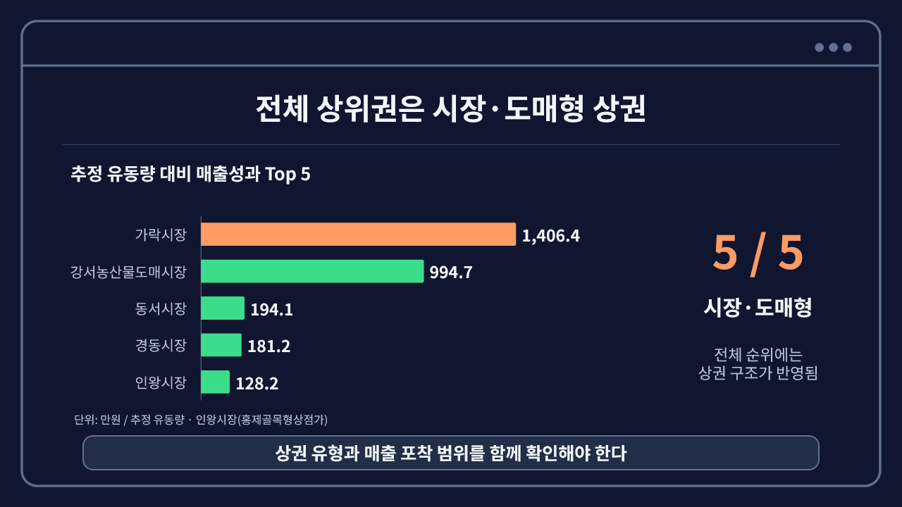

# 서울 상권 유동량 대비 매출성과 분석

**2025년 1~4분기 공공데이터로 1,558개 상권의 매출·거래·업종 구조를 비교한 개인 프로젝트입니다.**

[대시보드 열기](https://datastudio.google.com/reporting/d8b2094c-6cb4-46ab-b319-6d493e19e47f) · [핵심 분석 노트북](notebooks/seoul_commercial_portfolio.ipynb) · [전체 분석 노트북](notebooks/seoul_commercial_analysis.ipynb) · [분석 상세](docs/analysis-notes.md)



## 확인한 질문

유동량 대비 매출성과가 높은 상권은 무엇이 다를까요? 순위만으로 평가하기 전에 상권 유형, 거래 발생 강도, 평균 결제금액과 업종 구성을 함께 비교했습니다.

## 핵심 결과

- 전체 상위 5곳은 시장·도매형 상권이었습니다. 상권 구조와 매출·유동량 자료의 포착 범위를 고려해야 합니다.
- 골목·발달·전통시장 유형별로 매출성과 상·하위 10%를 선정해 통합 중앙값을 비교했습니다. 거래 발생 강도는 약 80배, 평균 결제금액은 약 1.3배 차이를 보였습니다.
- 강남 마이스 관광특구는 서울 전체 연간 9위이며 네 분기 모두 상위 10위권이었습니다. 업종 HHI는 0.093, 나머지 관광특구 5곳의 중앙값은 0.119였습니다.
- 주변 상권 수와 매출성과의 순위상관은 약했습니다. 500m는 0.029, 1km는 -0.048이었습니다.

## 데이터와 지표

| 항목 | 내용 |
|---|---|
| 분석 기간 | 2025년 1~4분기 |
| 원본 | 추정매출·점포·유동인구·직장인구·집객시설·상권영역·상권변화지표 7종 |
| 마트 집계 단위 | 분기 × 상권, 6,276행 |
| 연간 분석 대상 | 4분기 매출·거래·유동량이 존재하고 각 합계가 양수인 1,558개 상권 |
| 매출성과 | 연간 매출액 / 연간 추정 유동량 |
| 거래 발생 강도 | 연간 매출건수 / 연간 추정 유동량 |
| 평균 결제금액 | 연간 매출액 / 연간 매출건수 |

`매출성과 = 거래 발생 강도 × 평균 결제금액`으로 분해했습니다. 유동량은 개인별 실제 방문자 수가 아니므로 이 비율을 실제 구매 전환율로 해석하지 않습니다.

## 구현 과정

1. Python으로 서울 공공데이터 API를 호출해 원본 CSV를 수집했습니다.
2. GCS 업로드와 BigQuery Raw 테이블 생성은 콘솔에서 수동 수행했습니다.
3. dbt staging에서 타입·컬럼·기간을 정리하고 mart에서 분기·상권 단위로 결합했습니다.
4. 고유키·분기·주요 컬럼을 검증하고 결측을 0으로 바꾸지 않고 분석했습니다.
5. Python으로 유형별 비교·성과 분해·업종 집중도·분기별 안정성을 분석했습니다.
6. Looker Studio에서 자치구·상권 유형·성과 유형·상권명 필터로 탐색할 수 있게 구성했습니다.

## 폴더 안내

```text
models/       dbt staging, mart SQL과 검증 정의
notebooks/    분석 코드와 요약 원고
scripts/      원본 수집 및 클라우드 적재 관련 코드
docs/         분석 상세와 실행 준비 안내
assets/       결과 미리보기 이미지
```

## 실행 준비

[실행 준비 안내](docs/setup.md)를 확인하세요. API 키와 GCP 인증은 개인 환경에서 설정해야 하며 원본 CSV와 인증 파일은 이 저장소에 포함하지 않습니다. 분석 노트북은 실행 코드와 Markdown 설명을 제공하며, 공개용 파일에서는 저장된 셀 출력과 실행 횟수를 비웠습니다.

## 해석의 한계

- 원천 추정자료와 포착 범위 차이의 영향을 받습니다.
- 유형별 상·하위 비교는 집단의 관측 특성 차이이며 원인 검증이 아닙니다.
- 상관계수는 통제된 인과효과가 아닙니다.
- 500m·1km는 좌표 단위가 미터라는 전제의 중심점 간 직선거리이며 실제 보행거리가 아닙니다.
- 고객·주문 단위 자료가 없어 실제 전환·재구매·수익성은 직접 검증하지 않았습니다.

## 수행 범위

개인 프로젝트로 문제 정의, 데이터 수집·통합, 지표 정의, 분석과 대시보드 구성을 수행했습니다. 참고 자료는 기존 분석 노트북의 저장된 결과이며 운영 매출 개선 성과를 주장하지 않습니다.
